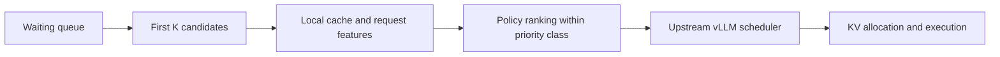

# CacheFlow Scheduler

**Cache-aware waiting-queue scheduling for vLLM V1.**

[](https://github.com/Sentinel3252/SLO-Aware-Cache-Scheduling-for-vLLM/actions/workflows/ci.yml)
[](pyproject.toml)
[](LICENSE)

[中文](README.zh-CN.md) · [Getting started](docs/getting-started.md) · [Configuration](docs/configuration.md) · [Contributing](CONTRIBUTING.md)

CacheFlow reorders vLLM's waiting queue using local prefix-cache hits, remaining
prefill work, request age, and TTFT targets. It plugs into a single V1 engine
through `--scheduler-cls`. vLLM still handles token budgets, KV allocation,
execution, and the request lifecycle.

You can use it to compare admission policies for RAG, multi-session, and
mixed-length workloads. The policies also run in CPU tests and a small ordering
simulator, which lets you inspect queue behavior before running GPU experiments.

## Features

- Six policies: FCFS, cache-first, residual-work, aging, CARAS, and SLO.
- At most `K` waiting candidates scored per scheduler cycle.
- Request priorities preserved, with preempted FCFS requests protected by default.
- Metrics for reorder time, candidate counts, overtakes, and queue size.
- Tools for seeded traces, streaming latency measurement, SLO reports,
  output comparison, and CPU policy comparisons.

**Status: early development (0.1.0).** The adapter uses private vLLM interfaces.
The dependency is pinned to vLLM `0.28.0`, but the recorded GPU run used a
`0.23.1` development build. The pinned version has not been validated on GPU.
See the [compatibility matrix](docs/compatibility.md) before deploying or upgrading.
The [recorded results](docs/results.md) show both improvements and regressions;
you will need to benchmark your own workload.

## Quick start — no GPU required

Python 3.10+ is sufficient for policy simulation. The core has no runtime dependencies.
The commands below install directly from the repository.

```bash
git clone https://github.com/Sentinel3252/SLO-Aware-Cache-Scheduling-for-vLLM.git
cd SLO-Aware-Cache-Scheduling-for-vLLM
python -m pip install -e .

cacheflow-generate --workload rag --count 100 --qps 4 --seed 7 --output results/rag.jsonl
cacheflow-simulate --trace results/rag.jsonl --mode fcfs --output results/fcfs.jsonl
cacheflow-simulate --trace results/rag.jsonl --mode caras --output results/caras.jsonl
cacheflow-report --input FCFS=results/fcfs.jsonl --input CARAS=results/caras.jsonl
```

The report shows TTFT percentiles, failures, SLO attainment, and SLO goodput.
These are **simulated values**, produced by a serial prefill model with an
unlimited prefix cache. They describe ordering behavior, not vLLM performance.
See [getting started](docs/getting-started.md) for virtual environments and CLI usage.
Replay checks each request and its unique ID before starting. Invalid records
report the trace path and line number. See the [trace format](docs/trace-format.md).

## Run with vLLM

On a Linux host with a compatible GPU runtime, install the pinned vLLM dependency
in the same environment as CacheFlow, then check the available interfaces:

```bash
python -m pip install -r requirements/vllm.txt
cacheflow-check-vllm

export CACHEFLOW_MODE=caras
export CACHEFLOW_CANDIDATE_WINDOW=16

vllm serve Qwen/Qwen2.5-0.5B-Instruct \
  --enable-prefix-caching \
  --enable-chunked-prefill \
  --stream-interval 1 \
  --no-async-scheduling \
  --scheduler-cls cacheflow.vllm_adapter.CARASScheduler
```

`cacheflow-check-vllm` checks interfaces only. After it passes, send real requests,
compare outputs with FCFS, and calibrate the cost model on your model/GPU before
measuring latency. Use the same async scheduling setting for every policy.
The [integration guide](docs/getting-started.md#run-a-vllm-server) covers baseline,
client, and rollback commands; [configuration](docs/configuration.md) documents
every environment variable.

## How it works



CARAS ranks estimated remaining work, reduces its score as a request ages, and
optionally applies a cache-reuse credit. SLO mode prioritizes requests estimated
to remain feasible, using slack and an age override. The override applies only
to visible candidates and cannot guarantee a deadline or a wall-clock wait bound.

CacheFlow changes admission order within one scheduler instance. It does not
route between workers, change cache eviction, query remote KV storage, or search
the whole queue for requests that fit available memory. Admission can still stop
when vLLM cannot allocate KV space for the chosen request.

## Documentation

| Guide | Contents |
| --- | --- |
| [Getting started](docs/getting-started.md) | Install, CPU walkthrough, serving, benchmarking, rollback |
| [Configuration](docs/configuration.md) | Policies, environment variables, telemetry, tuning |
| [Architecture](docs/architecture.md) | Queue contract, feature probes, cost model, scheduler boundary |
| [Compatibility](docs/compatibility.md) | Integration target, validation levels, upgrade procedure |
| [Benchmark methodology](docs/benchmark-methodology.md) | Fair comparisons, correctness checks, metric limitations |
| [Results](docs/results.md) | Historical measurements and missing evidence |
| [Design rationale](docs/problem-audit.md) | Tradeoffs and upstream references |
| [Roadmap](ROADMAP.md) | Planned work and acceptance criteria |

## Contribute

Bug reports, compatibility fixes, documentation improvements, and reproducible
workload reports are welcome. Start with [CONTRIBUTING.md](CONTRIBUTING.md).
Run the dependency-free test suite from a checkout:

```bash
python -m unittest discover -v
```

Use [GitHub Issues](https://github.com/Sentinel3252/SLO-Aware-Cache-Scheduling-for-vLLM/issues)
for questions and reproducible bugs. Follow the [community guidelines](CODE_OF_CONDUCT.md)
and [security reporting policy](SECURITY.md) when contributing.

## License

[Apache-2.0](LICENSE). CacheFlow is an independent project and is not an official
vLLM component.
